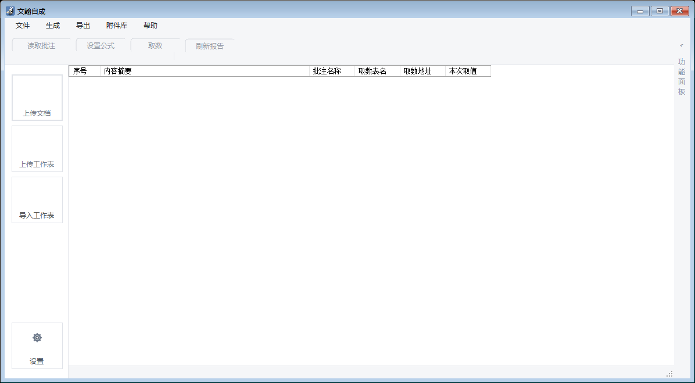

# 文翰自成

<p align="center">
  
</p>

**Windows 桌面评估工具** · 基于 .NET Framework 4.8 + WPS COM 自动化

把评估明细表（Excel/WPS 表格）的数据，按批注名称自动回填到 WPS 评估报告中，支持批量报告生成、照片排版、工作底稿一键生成，全程保留批注不丢失。

---

## 功能特性

| 功能 | 说明 |
|------|------|
| **批注回填** | 读取 WPS 文档中的批注，按批注名称与表格单元格地址对应，自动将表格值替换到文档正文，批注保留不消失 |
| **批量报告生成** | 支持多户批量生成评估报告，按批注协议（`WH_PH:{json}`）承载字段映射，逐户独立生成 |
| **照片排版** | 自动将评估对象实景照片按指定数量排版到文档，每页 N 张，附带「评估对象部分实景照片」标题 |
| **工作底稿一键生成** | 从 WPS 表格读取源数据，按 JSON 坐标契约自动填充工作底稿模板 |
| **承诺函生成** | 自动读取委托信息生成估价师承诺函，支持模板与附件库双来源 |
| **附件库** | 软件级附件库，跨项目共享，不随项目文件（.sco）保存 |
| **自动更新** | 6 源并发检测更新（GitHub API + jsDelivr + raw GitHub + 3 个加速镜像），取版本号最高的结果；安装包自动强杀旧进程、静默卸载旧版、覆盖安装；下载带完整性校验与提权路径白名单 |
| **WPS 窗口自适应** | 打开文档/工作表时自动将真实 WPS 窗口最大化，避免小框显示；编辑过程中状态图标保持稳定，不会误判关闭 |
| **安全加固** | 反馈授权码 DPAPI 加密存储（不随包明文发布）；正式授权防时钟回拨、试用期防时间跳变 |

---

## 界面预览

### 主界面



主界面自上而下分为三块：

- **顶部菜单栏**：`文件` / `生成` / `导出` / `附件库` / `帮助`，下方是常用操作按钮（`读取批注` / `设置公式` / `取数` / `刷新报告`）
- **左侧功能区**：`上传文档` / `上传工作表` / `导入工作表`，底部齿轮为`设置`入口；右侧边缘为可折叠侧边栏导轨（`Ctrl+B` 展开/收起，面板内容暂为空）
- **中央批注表格**：显示序号、内容摘要、批注名称、取数表名、取数地址、本次取值，取数与刷新结果一目了然

> 其余界面入口：点击左下角齿轮打开「设置」（标签页含快捷键、接口设置等）；顶部「生成」菜单包含工作底稿一键生成、承诺函、批量报告生成等功能。这些界面截图将在后续版本补齐。

---

## 快速开始

### 下载与安装

1. 前往 [GitHub Releases](https://github.com/sdj365/wenhan-update/releases) 下载最新版 `wenhan_vX.Y.Z.W_setup.exe`
2. 双击运行安装包，安装程序会自动卸载旧版本并覆盖安装
3. 安装完成后启动「文翰自成」

### 环境要求

- **操作系统**：Windows 7 SP1 及以上（64 位推荐）
- **WPS Office**：已安装 WPS 文字 + WPS 表格（推荐）
- **.NET Framework**：4.8（Windows 10/11 内置）
- **注册**：RSA 注册码授权（7 天试用）

### 首次使用

1. 启动软件后，点击「新建」或「打开」加载评估项目
2. 准备 WPS 文档（.wps/.doc/.docx）和评估明细表（.et/.xls/.xlsx）
3. 在文档中添加批注，批注名称对应表格中的字段名
4. 点击「读取批注」→「设置公式」→「取数」→「刷新报告」

---

## 核心工作流程

```
WPS 文档（含批注）  +  WPS 表格（评估明细）
         ↓
    读取批注列表 → 批注名称 → 匹配表格单元格地址
         ↓
    取数：从表格中读取实际值
         ↓
    刷新报告：替换文档正文中的标注文本
         ↓
    输出：原文件名_已刷新.docx（批注保留）
```

### 批注协议

批量报告生成使用 `WH_PH:{json}` 批注协议：

- **正文承载值**：批注锚定的文本位置
- **批注承载定义**：批注内容中定义字段名、取数来源、默认值等

示例：
```
批注内容：WH_PH:{"name":"委托单位","source":"Sheet1","cell":"B2"}
```

---

## 自动更新

### 检测机制

软件启动时后台并发请求 **6 个地址**，取版本号最高的结果，避免单个 CDN 缓存误导：

| 源 | 说明 |
|---|------|
| jsDelivr | **主源**，CDN 加速（单位网友好），读取 `version.json` 的 version / url / note |
| GitHub Releases API | 按 `published_at` 取最新正式版（排除 draft / prerelease），避免 `/releases/latest` 被钉在旧版 |
| ghfast.top | 加速镜像备用 |
| gh-proxy.com | 加速镜像备用 |
| ghproxy.net | 加速镜像备用 |
| raw GitHub | 官方直连兜底 |

### 升级流程

1. 检测到新版本 → 弹出「发现新版本」对话框
2. 点击「立即更新」→ 下载安装包到临时目录
3. 安装包启动时**强制结束旧进程**（`taskkill /F`），释放文件锁
4. 静默卸载旧版本 → 覆盖安装新版本
5. 无需重启，安装完成即可使用新版本

### 镜像加速（设置 → 接口设置）

打开「设置」→「接口设置」标签页可手动选择下载镜像接口，选定后自动更新默认使用该接口：

- **自动** — 默认，按测速结果排序
- **GitHub 直连** — 不走代理
- **ghfast.top / gh-proxy.com / ghproxy.net** — 第三方加速

点击「测速」可测试所有镜像源延迟，选择最优源。

---

## 更新日志

### v2.22.0.23（2026-11-21）

**本次重点：最大化边角遮挡 + 工具栏按钮边框两处 UI 瑕疵修复，底稿三项菜单暂时隐藏**

- **修复**：文档最大化后四边内容被任务栏遮挡——不再使用 Windows 标准外扩矩形，最大化后自动拉回显示器工作区，与 WPS 原生最大化一致
- **修复**：「读取批注 / 设置公式 / 取数 / 刷新报告」按钮的右边框、下边框缺失——内层背景矩形右下各缩 1px，四周边框完整闭合
- **调整**：移除报告刷新后的右上角变更导航浮窗（变更清单仍在刷新完成弹窗中）
- **调整**：清空右侧功能侧边栏内容（导轨与面板框架保留，Ctrl+B 仍可展开，展开为空白面板）
- **调整**：暂时隐藏「生成 → 底稿」三项（一键生成并绑定 / 字段映射配置 / 工作底稿数据绑定），「一键生成工作底稿」保留；部署完成后把 `ShowDraftExtraMenus` 改为 `true` 重编译即恢复

> 完整更新说明见 [更新说明_v2.22.0.23.md](更新说明_v2.22.0.23.md)

### v2.22.0.22（2026-11-19）

**本次重点：修复 v21 两个影响使用的问题**

- **修复**：变更导航浮窗点 ▲/▼ 时 Word 与文翰自成来回切换（焦点震荡）——浮窗不再抢焦点，实测连点无震荡
- **修复**：承诺函生成误报“请先在 WPS 中打开评估明细表”——直接在 WPS 打开明细表（未走上传流程）时也能生成

> 完整更新说明见 [更新说明_v2.22.0.22.md](更新说明_v2.22.0.22.md)

### v2.22.0.21（2026-11-19）

**本次重点：报告刷新变更导航 + 缓存目录访问被拒修复**

- **新增**：二次及以后刷新报告时，弹窗列出本次改动的页码与摘要；Word 右上角出现深色导航浮窗，点 ▲/▼ 循环跳转到各改动处（不改文档、不加高亮，打印/保存无痕）
- **新增**：导航浮窗只在 WPS 文字文档为当前窗口时显示，切到表格/其它程序自动隐藏，关闭文档即销毁
- **修复**：偶发“还原项目文档失败：访问被拒绝”——缓存目录重建不再沿用可能被占用的旧目录

> 完整更新说明见 [更新说明_v2.22.0.21.md](更新说明_v2.22.0.21.md)

### v2.22.0.20（2026-11-18）

**本次重点：窗口最大化彻底修复——状态栏不再被任务栏裁掉**

- **修复**：v19 打开文档/表格后，WPS 底部状态栏（缩放滑块、全屏按钮）被任务栏遮挡约 8px——新版 WPS 真正的顶层框架是 Chromium 窗口（Chrome_WidgetWin_1），此前只最大化了内部辅助窗口；现优先对 WPS 的 Chromium 顶层框架执行标准最大化（按进程过滤，不影响浏览器），与手动点击最大化效果完全一致
- **兼容**：保留旧版 WPS（非 Chromium 框架）的兜底最大化逻辑

> 完整更新说明见 [更新说明_v2.22.0.20.md](更新说明_v2.22.0.20.md)

### v2.22.0.19（2026-11-18）

**本次重点：WPS 窗口全屏化 + 编辑误弹保存框修复 + 全面安全加固**

- **修复**：打开项目文档/工作表时 WPS 窗口总是显示为小框——WPS COM 回报的窗口状态与真实屏幕窗口脱节，现改用 Win32 按真实框架窗口强制最大化，打开即全屏
- **修复**：编辑工作表时无故弹出「是否保存」框、取消后绿点消失且重开变只读——工作表存活探测恢复为稳定实现
- **安全**：反馈授权码改为 DPAPI 加密存储，不再明文随包发布
- **授权**：正式授权增加时间棘轮防回拨、试用期增加时间跳变阈值
- **稳定**：更新下载增加 PE 头与 SHA-256 校验、提权路径白名单；合并单元格取值、批注解析、CSV 转义、配置损坏保护、PDF 导出刷新、快捷键录入、侧边栏滚轮等多项修复

> 完整更新说明见 [更新说明_v2.22.0.19.md](更新说明_v2.22.0.19.md)

### v2.22.0.18（2026-11-16）

**本次重点：修复工作表打开状态不同步**

- **修复**：系统休眠恢复或长时间未操作后，WPS 表格窗口仍开着、但左侧「工作表」图标显示「点击打开」的状态脱节问题——现自动识别并复用 WPS 中已打开的项目工作簿，无需重新点开，避免重复开窗
- **说明**：本次无业务功能变更

> 完整更新说明见 [更新说明_v2.22.0.18.md](更新说明_v2.22.0.18.md)

### v2.22.0.17（2026-11-06）

**本次重点：品牌图标圆角化 + 自动更新下载修复 + GitHub 展示文档校准**

- **更换**：软件图标与文档 logo 改为品牌兔子形象（蓝底**圆角方形**、无水印，四角透明），exe、安装包、桌面快捷方式、`.sco` 文件关联图标全链路同步
- **修复**：自动更新下载失败时，错误提示不再沿用「检查更新」阶段的旧错误，改为显示真实下载地址与 HTTP 状态
- **修复**：遇 404 等地址级错误不再逐个更换镜像源重试，直接给出明确提示
- **校准**：README 图标引用改用已跟踪的 `AppIcon_preview.png`，解决 GitHub 上顶部 logo 裂图
- **校准**：自动更新说明按代码实际的 6 个检测地址重写，设置入口统一为「接口设置」
- **说明**：本次无业务功能变更

> 完整更新说明见 [更新说明_v2.22.0.17.md](更新说明_v2.22.0.17.md)

### v2.22.0.16（2026-11-05）

**本次重点：设置面板改版 + 自定义快捷键 + 分发渠道收敛**

- **改版**：设置面板改为「顶部标签页 + 卡片式行列表」，分类查看更紧凑，后续新增设置项不会撑长界面
- **新增**：「快捷键设置」——可为读取批注、设置公式、取数、刷新报告绑定个性化快捷键，支持修改 / 清除、冲突检测（含系统保留 `Ctrl+B`）、即改即存
- **调整**：「接口设置」——选定加速镜像接口后，自动更新默认使用该接口
- **调整**：分发渠道统一收敛为 GitHub Releases

> 完整更新说明见 [更新说明_v2.22.0.16.md](更新说明_v2.22.0.16.md)

### v2.22.0.15（2026-11-03）

**本次重点：修复自动更新升级后仍为旧版本的问题**

- **修复**：自动更新升级后仍为旧版本、反复提示更新——根因为旧进程未彻底退出、占用 exe 文件锁，导致静默卸载旧版时无法替换。现已改为安装包强制结束旧进程（`taskkill /F`）+ 硬退出当前进程（`Environment.Exit(0)`），升级可正确生效
- **修复**：照片排版偶发「RPC 服务器不可用 (0x800706BA)」——WPS 文字进程退出后残留的僵尸 COM 引用未检测，现已在生成前做存活检测并自动重建
- **新增**：顶层「设置」菜单，内含「更新加速」组（镜像源选择 + 测速）
- **新增**：工作底稿「一键生成并绑定」
- **增强**：工作底稿数据绑定（下拉选表、网格点选、预览取值、批量导入）

> 完整更新历史见 [更新说明_v2.22.0.15.md](更新说明_v2.22.0.15.md)

---

## 技术栈

| 技术 | 用途 |
|------|------|
| C# / .NET Framework 4.8 | 主程序（WinForms） |
| WPS COM 自动化 | WPS 文档/表格操作（动态类型后期绑定） |
| NPOI | Excel/WPS 表格读写（批量报告、工作底稿） |
| Inno Setup 6 | 安装包打包 |
| PdfiumViewer | PDF 导出与预览 |

---

## 下载

| 渠道 | 地址 |
|------|------|
| **GitHub Releases** | [https://github.com/sdj365/wenhan-update/releases](https://github.com/sdj365/wenhan-update/releases) |

安装包命名规则：`wenhan_vX.Y.Z.W_setup.exe`

---

## 常见问题

### 安装包升级后为什么还是旧版本？

v2.22.0.15 已修复此问题。旧版（v2.22.0.13 及更早）存在文件锁竞态——旧进程未彻底退出时，静默卸载无法替换被锁的 exe。升级到 v2.22.0.15 后，安装包会自动强制结束旧进程，升级可靠生效。

### 照片排版报错「RPC 服务器不可用」？

v2.22.0.15 已修复。根因为 WPS 文字进程退出后残留僵尸 COM 引用，现已做存活检测并自动重建。如仍出现，请完全关闭 WPS 后重试。

### 单位网无法访问 GitHub？

软件内置多镜像源检测。在「设置 → 接口设置」中选择 `ghfast.top` 或 `ghproxy.net` 加速源。也可前往 GitHub Releases 手动下载安装包。

### 需要安装 Microsoft Office 吗？

不需要。软件通过 WPS COM 接口操作文档，仅需安装 WPS Office。如已安装 Microsoft Office，程序会自动作为后备使用。

### 打开文档/表格时 WPS 窗口很小？

v2.22.0.19 已修复，v2.22.0.20 进一步修正：此前 WPS COM 回报的窗口状态与真实屏幕窗口不一致导致小框显示；现改用 Win32 按真实框架窗口强制最大化，打开即全屏（v20 起对 WPS 的 Chromium 顶层框架最大化，状态栏完整不再被任务栏遮挡）。

### 编辑表格时弹出「是否保存」框、绿点消失或重开变只读？

v2.22.0.19 已修复。此前工作表存活探测误判导致误触发清理流程，现恢复为稳定实现，编辑时绿点保持、不再误弹保存框。

---

## 注意事项

- **WPS 依赖**：所有文档/表格操作依赖本机 WPS Office（文字 + 表格）。请确保已安装并可正常打开相应文件；首次使用建议先手动用 WPS 打开一次文档，确认无授权弹窗。
- **工作副本机制**：WPS 只打开项目的工作副本，本地原始文件不会被修改。关闭软件时若有未保存改动，会询问是否「作为项目保存」；不保存则本地原文件保持不变。
- **授权**：首次运行有 7 天试用期，正式使用需 RSA 注册码。授权到期判断含防时钟回拨机制，请勿随意修改系统日期。
- **反馈授权码**：如使用内置反馈功能，授权码以加密形式存于本机用户目录，不随安装包分发；更换电脑后需重新配置。
- **项目文件**：项目以 `.sco` 为扩展名；附件库为软件级、跨项目共享，不随 `.sco` 保存。
- **截图**：本页主界面截图取自 v2.22.0.19 实机运行；界面随版本可能微调，以实际软件为准。

---

## 许可证

RSA 注册码授权（7 天试用）。如需购买注册码，请联系作者。

---

<p align="center">© 2026 文翰自成 · 基于 WPS Office COM 自动化</p>
